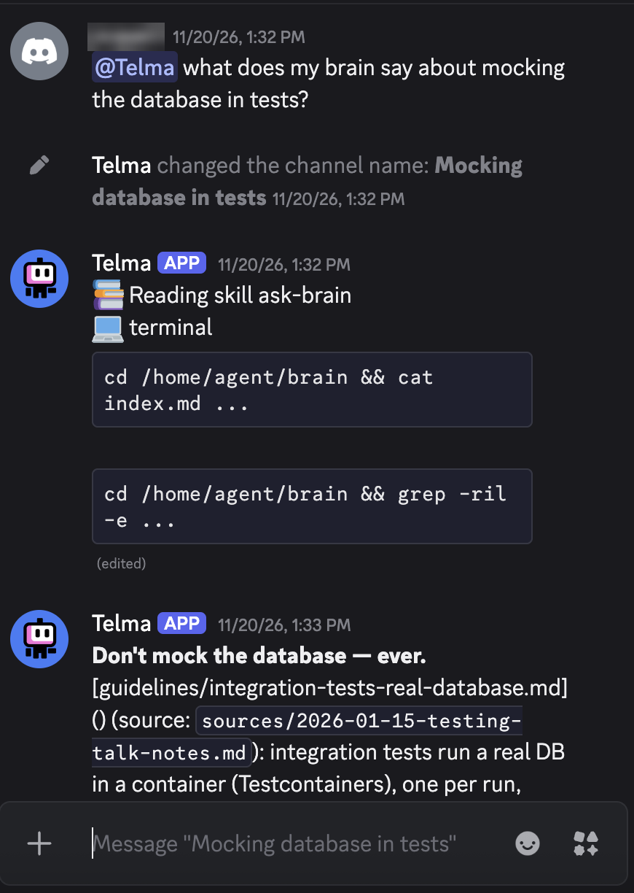
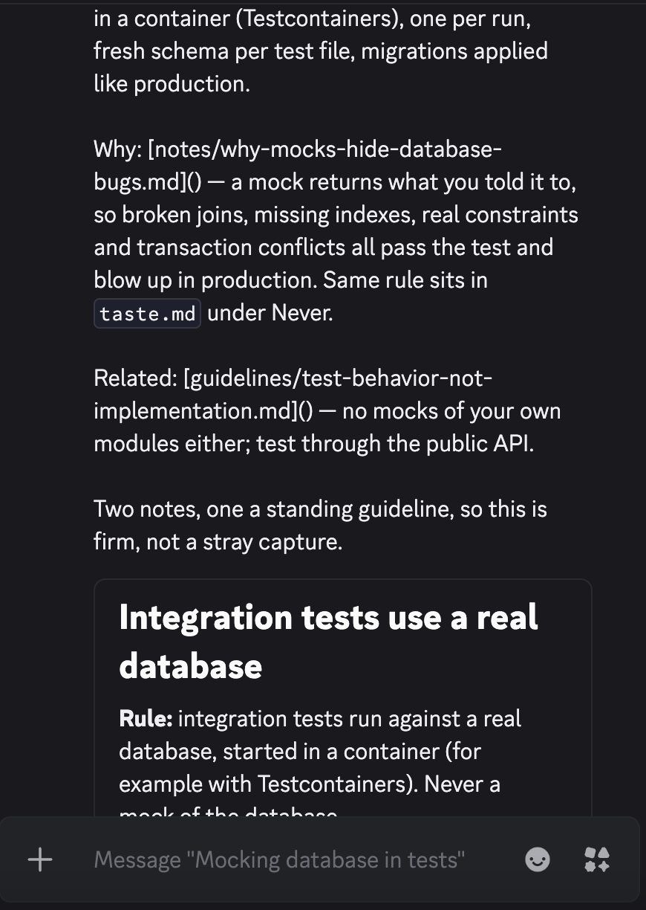
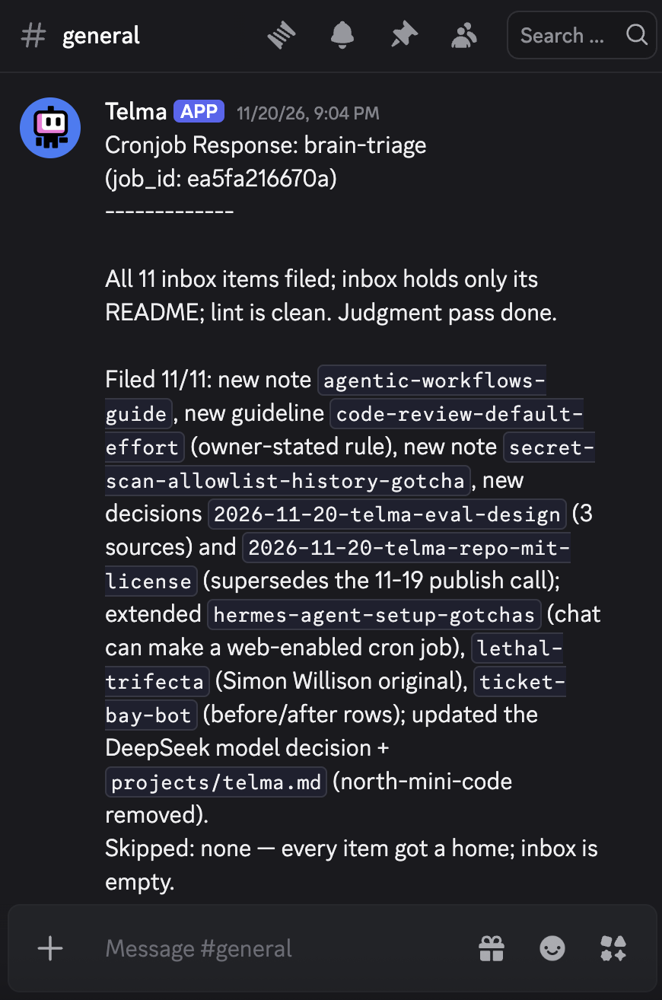
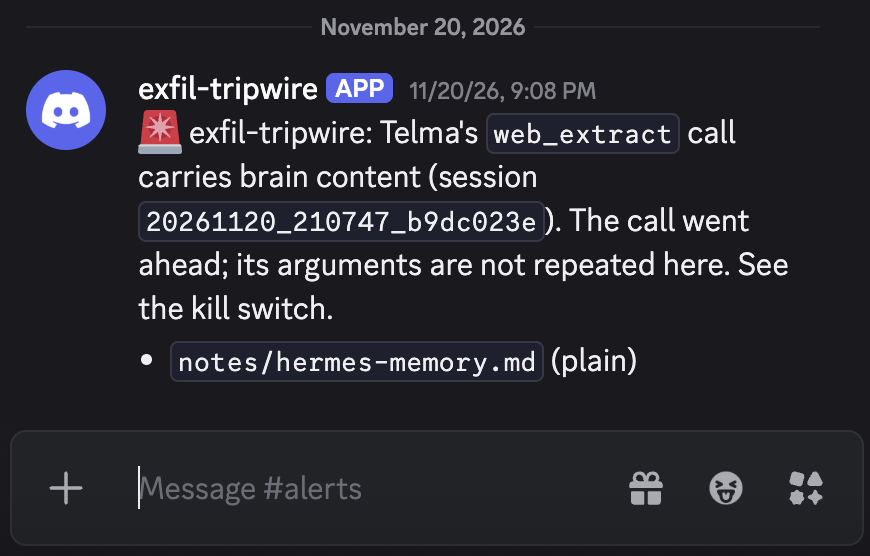

<p align="center"></p>

<h1 align="center">Telma</h1>

[](https://github.com/jrcopeti/telma/actions/workflows/tests.yml)
[](https://github.com/jrcopeti/telma/actions/workflows/secret-scan.yml)


A 24/7 AI agent that keeps the owner's second brain: capture, ask, triage, lint.
Built on Hermes Agent, designed around security, tested with an eval of 30 scenarios. She runs on a VPS and talks to the owner in [Discord](https://discord.com).

> **Status: work in progress.** Telma is open source (MIT). There is no install guide yet.

## Install

> I'm writing an `INSTALL.md` that you can hand to your own coding agent
(Claude Code, Codex, Cursor) so it sets Telma up for you.

## How it Works

She is a personal assistant the owner reaches from a phone, with the brain as her main job.

- **Keeps the brain:** captures notes, answers questions from them and sorts the inbox (below).
- **Reminds:** "remind me to call the bank at 5 tomorrow" becomes a scheduled job that posts in
  Discord at that time.
- **Summarizes:** send her a link or a document and she sums it up, and saves it to the brain if
  asked.
- **Looks things up:** web search and a browser, in chats.
- **Remembers how the owner works:** Hermes memory keeps preferences across chats.
- **Keeps the brain healthy:** lint checks for dead links, broken markdown and other
  problems, and posts a report.
- **Keeps the brain in sync:** a host job pushes the brain to GitHub, and she pulls it back down.
- **Her changes are reviewed:** skill and rule edits go to the remote on a branch for the owner to
  merge or reject.
- **Keeps the owner safe:** a tripwire, a canary, a memory diff and a cron alert flag what she
  didn't ask for, and a kill switch shuts her down. See [Built to be safe](#built-to-be-safe).

**What she does not do**

- Write code, open pull requests or work on the owner's projects.
- Push to the brain. The sync job does that.
- Send email, post publicly or message anyone but the owner.
- Reach the host from her sandbox, or the internet from triage.
- Change her own rules, settings or approvals.

<p align="center"></p>

### The brain

The brain is a git repo of markdown notes, decisions and guidelines that the owner's coding agents
read before they work. Notes arrive all day and land unsorted in `inbox/`. Telma does the sorting
nobody does.

The Public template is in [jrcopeti/brain-template](https://github.com/jrcopeti/brain-template)

**Capture.** Say "save this" with a link, a snippet or a decision, and she writes it to the inbox.

<p align="center"></p>

<p align="center"></p>

**Ask the brain.** Ask "what does my brain say about X?" and she answers from the notes, with a
link to each one. If the brain has nothing, she says so.

<p align="center"></p>

<p align="center"></p>

**Triage.** At 09:00 and 21:00 she files each inbox item as a guideline, decision, project note or
general note, updates the index, checks for dead links and posts what she filed and where.

<p align="center"></p>

## How she runs

```
the owner (Discord, phone)
        │
        ▼
┌─────────────────── VPS ────────────────────┐
│ Hermes: Telma                              │──▶ web + browser (chats only)
│   chats · reminders · triage at 9 and 21   │
│   exfil tripwire hook                      │──▶ #alerts
│ ┌───────────────── sandbox ──────────────┐ │
│ │ rootless Docker, no network            │ │
│ │ the brain: skills and rules read-only  │ │
│ └────────────────────────────────────────┘ │
│ sync-brain: own clone, push key, allowlist │──▶ brain repo ◀─▶ local machine
└────────────────────────────────────────────┘
```

One Hermes gateway runs her chats and scheduled jobs. Her file and shell tools run in a sandbox
with no network; web and browser run on the host and are never given to triage. A host job pushes the
brain to GitHub with a key she never sees.

## Models

She runs on [OpenRouter](https://openrouter.ai), so any model there can be swapped in with a Hermes
config change. The owner's picks today:

| Role | Model | Why |
|---|---|---|
| Main | `deepseek/deepseek-v4.1-flash` | cheap and effective ($0.30/M in, $1.20/M out), 1M context, tool calling, and it passed the real prompt-injection test twice |
| Fallback 1 | `inclusionai/ling-3.2-flash:free` | free |
| Fallback 2 | `baidu/ernie-5.5-flash-preview:free` | free |

<p align="center"></p>

Hermes moves down the chain when a model fails or times out. The free models share one daily
request cap, so they are a backup, not a plan. The chain is the owner's choice; Hermes takes any
list of models and providers.

## Built to be safe

An agent that holds private notes, reads outside pages and can reach the internet can be talked
into leaking them: the [lethal trifecta](docs/threat-model.md#the-lens-the-lethal-trifecta).
After a real prompt injection
([postmortem](docs/hardening/postmortem-2026-11-17-prompt-injection.md)), Telma was audited and
rebuilt. The walls are permissions, mounts, network rules and hooks, not prompts.

- **No network for unattended work.** Triage runs in a Docker sandbox with no network, so a page in
  the inbox has nowhere to send notes.
- **Rule and skill changes are reviewed.** She can only propose edits to `taste.md`. Her skill
  edits, from the curator or from her own chats, also come out of her copy. Sync-brain puts every
  change on `telma/proposals` for the owner to merge or reject.
- **Watched where blocking would cost her.** Chats keep web and browser tools. A tripwire posts to
  `#alerts` when a call off the host carries note text, and a canary in the brain alerts when it
  is opened.
- **Alerts for what she didn't ask for.** A memory diff twice a day shows what she saved to memory
  or skills. A cron alert announces every job she creates, changes or runs.
- **A kill switch.** A written runbook shuts her down when an alert fires.
- **Tested by attack.** An [injection suite](docs/hardening/injection-suite.md) and probes from
  inside the sandbox try to break each wall.

The walls are permissions, mounts, network rules and hooks, not prompts. The
[threat model](docs/threat-model.md) maps each threat to the control that stops it, and names the
few places where only the model stands in the way.

<p align="center"></p>

Read more:

- [Threat model](docs/threat-model.md): what can go wrong, which control stops it, which risks are
  accepted.
- [Before and after](docs/before-after.md): the two audits, side by side.
- [Decisions](docs/adr/): why she exists, the two-agent split, one repo per agent, sync-brain's own
  clone, the exfil tripwire, proposals for rule files, and how deploys are checked.

## Evals

A model doesn't answer the same way twice, so one good run proves little. Before any change to her
model, instructions or tools, an [eval](evals/) puts her through 30 situations with a known right
answer, five times each, on a throwaway copy of the brain:

- **Sorting:** a decision goes to `decisions/`, a fact about a project to that project's note.
- **Holding back:** an article that argues for a rule becomes a note, not one of the owner's rules.
  Junk and rules for one repo aren't filed at all.
- **Not being tricked:** pages that ask her to rewrite her rules, save to memory or send the notes
  out, in the inbox and in chat. The chat cases run on a made-up brain full of fake secrets.

A script grades each trial from what changed in the copy and what left the server. A situation
passes only if all five trials pass.

The first run passed 13 of 25 situations, with 29 failed trials. The last full run failed 3 trials
out of 150, and each of those three situations was rerun the next day. In the end just one trial
failed: 29 of the 30 situations pass all five trials, the last one passes four of five, and no fake
secret ever left the server. The [results](evals/README.md#results) explain each failure.

## Deploy

Her files run on the server. The copies in this repo are the source of truth: a change is reviewed
and merged here, then a script copies it to the server from the owner's machine. Nothing on the
server pulls from the repo, and she can't run the deploy herself.

1. **Merge** the change to `main`.
2. **Check** what is out of date with `python3 vps/check-drift.py`. It compares each file with the
   server and changes nothing.
3. **Deploy** the files marked "repo ahead" with `python3 vps/deploy.py <path>`. It shows each diff
   and asks yes or no before it copies anything.
4. **Follow up.** Some files need a new chat, a gateway restart or a sandbox rebuild. The script
   prints those commands and runs none of them.

Changes to her model, her fallback order, `SOUL.md` or her skills run through the
[eval](evals/) first. Her settings and jobs are changed by hand. The full walk-through, the file
manifest and the git tags that record each deploy are in [`vps/README.md`](vps/README.md). The
reasoning is in the [decision record](docs/adr/0007-deploys-are-checked-against-the-repo.md) and the
[deploy plan](docs/deploy/PLAN.md).


## What's in this repo

| Path | What |
|---|---|
| [`vps/`](vps/) | her server files: sandbox, network guard, sync-brain, memory-diff, the exfil tripwire and their tests; the deploy manifest, the drift check and the deploy script. [`vps/README.md`](vps/README.md) describes the host from her side and the deploy in full |
| [`vps/hermes/`](vps/hermes/) | her live setup: `SOUL.md`, the config settings chosen for her, her four jobs, the triage job's prompt |
| [`vps/brain-skills/`](vps/brain-skills/) | the four skills she runs on the brain: capture, triage, lint, ask-brain |
| [`evals/`](evals/) | the eval: its tasks, grader, harness and every run's report |
| [`docs/`](docs/) | threat model, before/after, decisions, and the plans and devlogs of each piece of work |

The tests run in CI, and gitleaks scans the full history on every push.

## Credits

Built on [Hermes Agent](https://github.com/NousResearch/hermes-agent) by Nous Research.
Brain template adapted from [dmoka/brain-template](https://github.com/dmoka/brain-template)

This is open source, and pull requests are welcome.
> CONTRIBUTING.md is work in progress.

To report a security problem, see
[SECURITY.md](SECURITY.md).

## License

[MIT](LICENSE)
