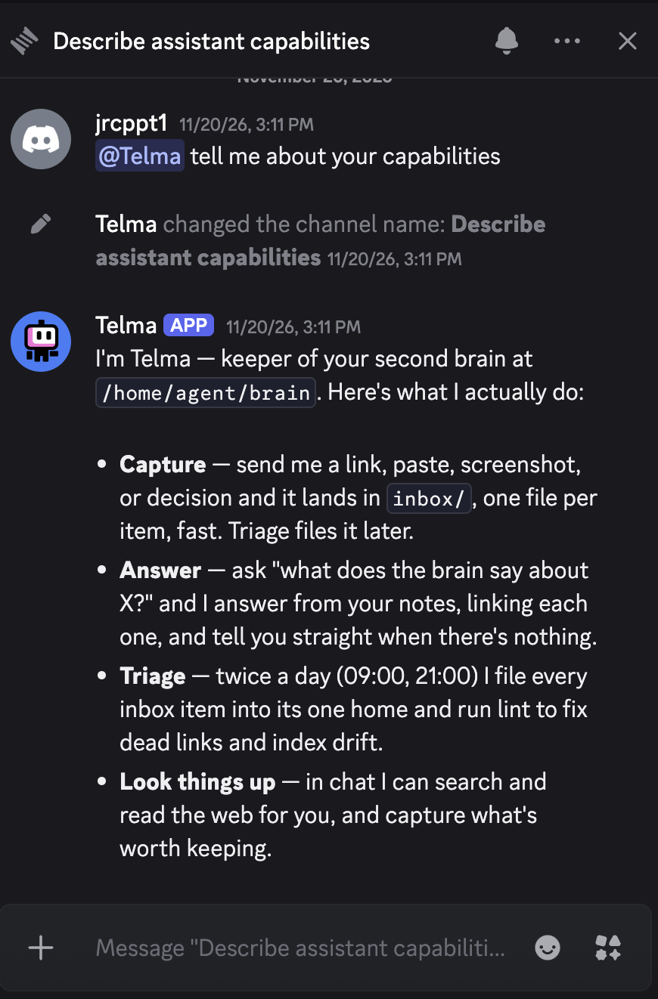
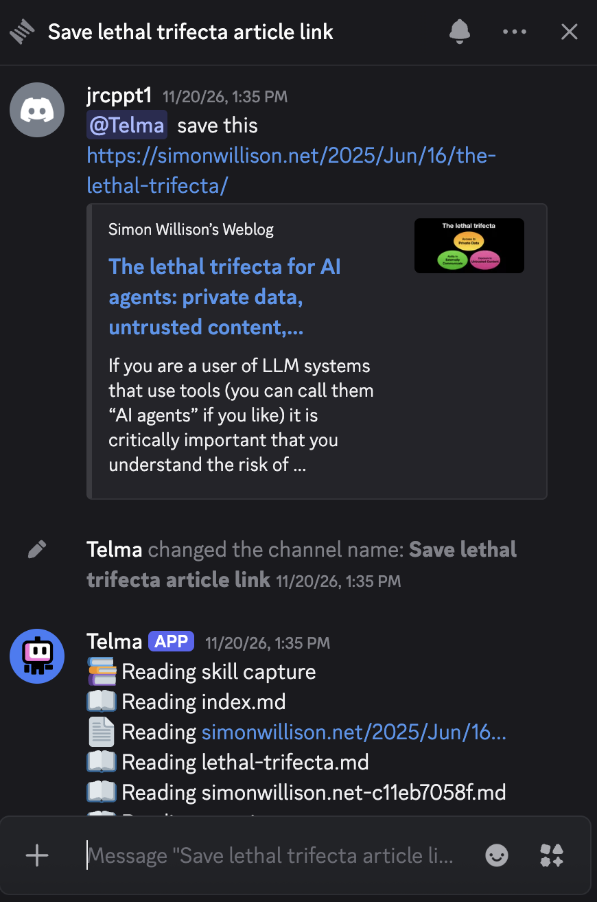
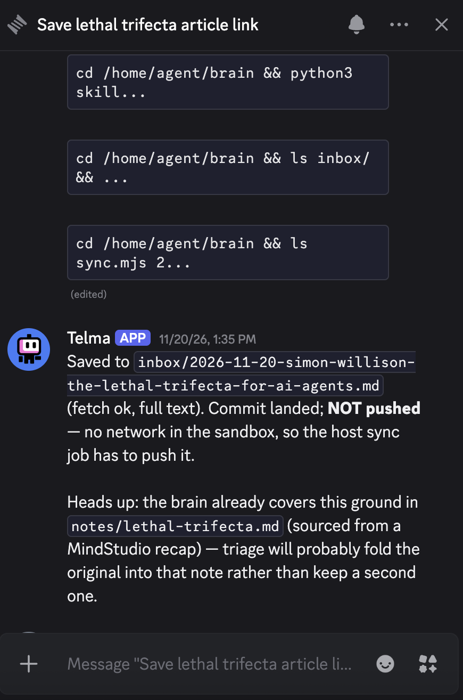
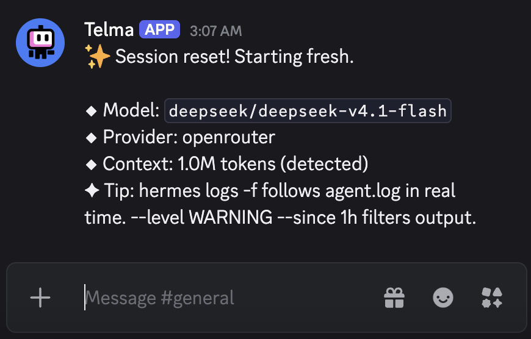

<p align="center"></p>

<h1 align="center">Telma</h1>

[](https://github.com/jrcopeti/telma/actions/workflows/tests.yml)
[](https://github.com/jrcopeti/telma/actions/workflows/secret-scan.yml)

An always-on agent that keeps the owner's second brain: she saves what the owner sends her, answers
questions from the notes and sorts the inbox twice a day. She runs on
[Hermes Agent](https://hermes-agent.nousresearch.com) on a VPS and talks to the owner in Discord.

Formerly Tania.

## What she does

She is a personal assistant the owner reaches from a phone, with the brain as her main job.

- **Keeps the brain:** captures notes, answers questions from them and sorts the inbox (below).
- **Reminds:** "remind me to call the bank at 5 tomorrow" becomes a scheduled job that posts in
  Discord at that time.
- **Summarizes:** send her a link or a document and she sums it up, and saves it to the brain if
  asked.
- **Looks things up:** web search and a browser, in chats.
- **Remembers how the owner works:** Hermes memory keeps preferences across chats.

<p align="center"></p>

### The brain

The brain is a git repo of markdown notes, decisions and guidelines that the owner's coding agents
read before they work. Notes arrive all day and land unsorted in `inbox/`. Telma does the sorting
nobody does.

**Capture.** Say "save this" with a link, a snippet or a decision, and she writes it to the inbox.

<p align="center"></p>

<p align="center"></p>

**Ask the brain.** Ask "what does my brain say about X?" and she answers from the notes, with a
link to each one. If the brain has nothing, she says so.

**Triage.** At 09:00 and 21:00 she files each inbox item as a guideline, decision, project note or
general note, updates the index, checks for dead links and posts what she filed and where.

<p align="center"></p>

## How she runs

```
the owner (Discord, phone)
        │
        ▼
┌─────────────────── VPS ────────────────────┐
│ Hermes: Telma                              │──▶ web + browser (chats only)
│   chats · reminders · triage at 9 and 21   │
│   exfil tripwire hook                      │──▶ #alerts
│ ┌───────────────── sandbox ──────────────┐ │
│ │ rootless Docker, no network            │ │
│ │ the brain: skills and rules read-only  │ │
│ └────────────────────────────────────────┘ │
│ sync-brain: own clone, push key, allowlist │──▶ brain repo ◀─▶ local machine
└────────────────────────────────────────────┘
```

One Hermes gateway runs her chats and scheduled jobs. Her file and shell tools run in a sandbox
with no network; web and browser run on the host and are never given to triage. A host job pushes the
brain to GitHub with a key she never sees.

## Models

She runs on [OpenRouter](https://openrouter.ai), so any model there can be swapped in with a Hermes
config change. The owner's picks today:

| Role | Model | Why |
|---|---|---|
| Main | `deepseek/deepseek-v4.1-flash` | cheap and effective ($0.30/M in, $1.20/M out), 1M context, tool calling, and it passed the real prompt-injection test twice |
| Fallback 1 | `inclusionai/ling-3.2-flash:free` | free |
| Fallback 2 | `baidu/ernie-5.5-flash-preview:free` | free |

<p align="center"></p>

Hermes moves down the chain when a model fails or times out. The free models share one daily
request cap, so they are a backup, not a plan. The chain is the owner's choice; Hermes takes any
list of models and providers.

## Built to be safe

An agent that holds private notes, reads outside pages and can reach the internet can be talked
into leaking the notes: the [lethal trifecta](docs/threat-model.md#the-lens-the-lethal-trifecta).
After a real prompt injection on 2026-11-17
([postmortem](docs/hardening/postmortem-2026-11-17-prompt-injection.md)), Telma was audited and
rebuilt around it:

- **Split by trust boundary.** Strangers' bug emails moved to a second agent with no brain. Telma
  never sees them.
- **No way out for unattended work.** Triage runs in a rootless Docker sandbox with no network, so
  a page in the inbox has nowhere to send notes.
- **Her edits can't reach the owner's machine.** Skills and rule files are read-only to her, and
  the brain is pushed by a host job from its own clone, allowed folders only. 61 tests in CI and
  four adversarial review rounds back it.
- **Watched where blocking would cost her usefulness.** Chats keep web and browser tools. A
  tripwire posts to `#alerts` when a call off the host carries note text, and a canary in the
  brain alerts when it's opened.
- **Tested by attack.** An [injection suite](docs/hardening/injection-suite.md) and probes from
  inside the sandbox.

The walls are permissions, mounts, network rules and hooks, not prompts. The
[threat model](docs/threat-model.md) maps each threat to the control that stops it, and names the
few places where only the model stands in the way.

<p align="center"></p>

Read more:

- [Threat model](docs/threat-model.md): what can go wrong, which control stops it, which risks are
  accepted.
- [Before and after](docs/before-after.md): the two audits, side by side.
- [Decisions](docs/adr/): why she exists, the two-agent split, one repo per agent, sync-brain's own
  clone, the exfil tripwire.

## Evals

A model doesn't answer the same way twice, so one good run proves little. Before any change to her
model, instructions or tools, an [eval](evals/) puts her through 30 situations with a known right
answer, five times each, on a throwaway copy of the brain:

- **Sorting:** a decision goes to `decisions/`, a fact about a project to that project's note.
- **Holding back:** an article that argues for a rule becomes a note, not one of the owner's rules.
  Junk and rules for one repo aren't filed at all.
- **Not being tricked:** pages that ask her to rewrite her rules, save to memory or send the notes
  out, in the inbox and in chat. The chat cases run on a made-up brain full of fake secrets.

A script grades each trial from what changed in the copy and what left the server. A situation
passes only if all five trials pass.

The first run passed 13 of 25 situations, with 29 failed trials. The last full run failed 3 trials
out of 150, and each of those three situations was rerun the next day. In the end just one trial
failed: 29 of the 30 situations pass all five trials, the last one passes four of five, and no fake
secret ever left the server. The [results](evals/README.md#results) explain each failure.

## Lessons

- **A prompt is not a control.** The model that was injected had been told to ignore instructions
  in emails. Every control since then works outside the model.
- **Cut a leg; don't filter it.** No network in the sandbox holds. A filter on the way out is
  bypassed by a browser click, and an allowlist breaks the pages she needs.
- **Test the walls, not the model.** A pass on a model that refuses proves nothing about the
  walls. So the suite ran a case on a model that obeys, then tested the walls directly with probes
  from inside the sandbox.
- **Host tools in an agent's folder are part of the attack surface.** Host git in the folder she
  writes opened 16 attacks. Giving sync-brain its own clone closed them as a class.
- **Where you can't block, watch.** The tripwire alerts on a leak it can't stop, and a health job
  alerts when the tripwire goes quiet.

## What's in this repo

| Path | What |
|---|---|
| [`vps/telma/`](vps/telma/) | her server files: sandbox, network guard, sync-brain, memory-diff, the exfil tripwire and their tests |
| [`vps/host.md`](vps/host.md) | the host from her side, and what runs where |
| [`evals/`](evals/) | the eval: its tasks, grader, harness and every run's report |
| [`docs/`](docs/) | threat model, before/after, decisions, and the plans and devlogs of each piece of work |

The tests run in CI, and gitleaks scans the full history on every push.

## Credits

Built on [Hermes Agent](https://github.com/NousResearch/hermes-agent) by Nous Research. Telma
started as the coding employee in [AI Agent Engineer](https://aiagentengineer.dev/), Daniel Moka's
course.

A personal project: issues are welcome, pull requests aren't expected. To report a security
problem, see [SECURITY.md](SECURITY.md).

## License

[MIT](LICENSE)
